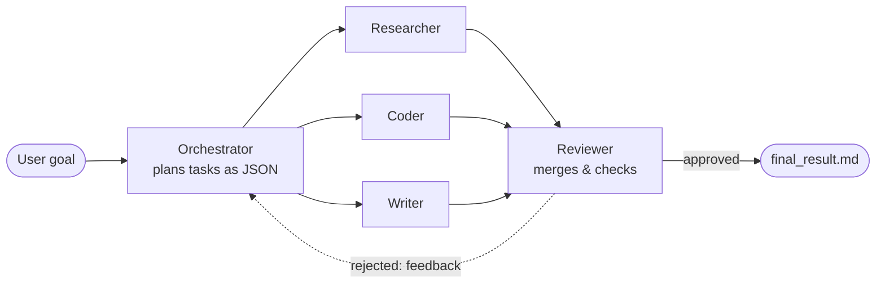

# agentic-team

A minimal **orchestrator-worker team of AI agents** in plain Python: no agent framework, a single file, and three interchangeable LLM providers (Google Gemini, Anthropic Claude, or a local model via Ollama).

An orchestrator splits a goal into tasks, specialist agents work on them in parallel, and a reviewer approves the result or sends it back with feedback for another round.



## Features

- **Orchestrator-worker pattern**: plan → parallel execution → review → retry, capped at `MAX_ROUNDS` (3)
- **Shared blackboard**: every agent sees the goal, all previous results and the reviewer's feedback
- **Three providers, one switch**: Gemini (default), Claude, or Ollama for free local models with no API key
- **Resilient API calls**: exponential backoff on `429`/`5xx`, fallback to the next model in a list, fail-fast on real errors (bad key, unknown model)
- **Robust JSON handling**: tolerates code fences, extra prose and small-model quirks, and re-asks the model when a reply can't be parsed
- **Offline mock mode**: run the whole loop without any API key or model
- **Full output saved** to `final_result.md`: the reviewer summary plus every task's complete answer

## Quick start

```bash
git clone https://github.com/AlainAhuili/agentic-team.git
cd agentic-team
python -m venv .venv
source .venv/Scripts/activate        # Windows Git Bash; Linux/macOS: source .venv/bin/activate
pip install -r requirements.txt

# Try it offline first: no key needed
export AGENT_MOCK=1
python agent_team.py "Build a CLI tool that checks if URLs in a README are alive"
```

Example output (mock mode):

```text
Provider: mock

=== Round 1 ===
  plan -> researcher List libraries for HTTP checks and Markdown link parsing.
  plan -> coder      Write the CLI in Python using the chosen libraries.
  plan -> writer     Write a short README with usage examples.
  done <- researcher #1
  done <- coder #2
  done <- writer #3
  reviewer: rejected -> Coder: add a timeout and exit code 1 on dead links.

=== Round 2 ===
  ...
  reviewer: approved
  saved full result to final_result.md
```

## Choosing a provider

Unset mock mode first: `unset AGENT_MOCK`.

### Google Gemini (default)

Get a free API key in [Google AI Studio](https://aistudio.google.com).

```bash
export GEMINI_API_KEY="your-key"
export GEMINI_MODEL="gemini-3.8-flash,gemini-3.5-flash"   # optional: preferred model, then fallbacks
python agent_team.py "your goal"
```

Model names change often. List the ones your key can use:

```bash
python -c "from google import genai; [print(m.name) for m in genai.Client().models.list()]"
```

On the free tier, set `MAX_PARALLEL=1` to stay under the per-minute rate limit.

### Anthropic Claude

Needs API credits in the [Anthropic Console](https://console.anthropic.com); a Claude.ai subscription doesn't include API usage.

```bash
export LLM_PROVIDER=anthropic
export ANTHROPIC_API_KEY="your-key"
python agent_team.py "your goal"
```

### Ollama (local, free, offline)

Install [Ollama](https://ollama.com), then:

```bash
ollama pull llama3.2                 # ~2 GB; with a GPU, try qwen2.5:7b for better results
export LLM_PROVIDER=ollama
export MAX_PARALLEL=1                # Ollama serves one request at a time by default
python agent_team.py "your goal"
```

## Configuration

All settings are environment variables.

| Variable | Default | Purpose |
|---|---|---|
| `LLM_PROVIDER` | `gemini` | `gemini`, `anthropic` or `ollama` |
| `AGENT_MOCK` | (unset) | `1` = offline mock mode, no API calls |
| `GEMINI_API_KEY` | (none) | Gemini API key |
| `GEMINI_MODEL` | `gemini-3.8-flash` | Comma-separated list; later entries are fallbacks |
| `ANTHROPIC_API_KEY` | (none) | Anthropic API key |
| `ANTHROPIC_MODEL` | `claude-sonnet-5-5` | Comma-separated list; later entries are fallbacks |
| `OLLAMA_MODEL` | `llama3.2` | Comma-separated list of local models |
| `OLLAMA_HOST` | `http://localhost:11434` | Ollama server address |
| `OLLAMA_TIMEOUT` | `600` | Seconds per request (local models can be slow) |
| `MAX_PARALLEL` | `3` | Maximum concurrent LLM calls |
| `RESULT_FILE` | `final_result.md` | Where the full result is written |

On Windows PowerShell, use `$env:NAME = "value"` instead of `export NAME=value`.

## How it works

Everything lives in [`agent_team.py`](agent_team.py):

| Part | Role |
|---|---|
| `call_llm()` | Single entry point to any model: mock mode, retries with backoff, model fallback, concurrency limit |
| `_call_gemini()`, `_call_anthropic()`, `_call_ollama()` | One small adapter per provider |
| `Agent` | A role = a system prompt; `run(task, context)` sends a task plus the shared context |
| `WORKERS`, `ORCHESTRATOR`, `REVIEWER` | The team. Add a worker by adding an entry to `WORKERS`; the orchestrator's prompt lists them automatically |
| `Blackboard` | Shared state: goal, one result per task, reviewer feedback |
| `ask_json()` | Asks an agent for JSON, validates it, re-asks with a stricter reminder if needed |
| `run_team()` | The loop: plan → `asyncio.gather` workers → review → approve or retry |

### Adding an agent

Add an entry to the `WORKERS` dict in `agent_team.py`. The orchestrator's prompt is built from this dict, so it can assign tasks to the new agent right away:

```python
WORKERS = {
    "researcher": Agent("researcher", "You are the researcher. ..."),
    "coder": Agent("coder", "You are the coder. ..."),
    "writer": Agent("writer", "You are the writer. ..."),
    "tester": Agent("tester", "You are the tester. Write pytest tests for the code produced so far."),
}
```

## Limitations and next steps

- **No task dependencies yet.** All tasks in a round run in parallel, so the coder can't wait for the researcher's findings. Next step: let the orchestrator declare `depends_on` and run tasks in stages.
- **Agents only produce text.** Giving workers tools (web search, file I/O, running tests) would make them far more useful.
- **Small local models** (3B) handle the orchestration loop but produce basic plans and code; 7–8B models are noticeably better.

## Author

Alain Roger Ahuili · [GitHub](https://github.com/AlainAhuili) · [LinkedIn](https://www.linkedin.com/in/alain-roger-ahuili-779b901b8/)
